# Space Fighter — Godot 4.7.2 / v1.8.0

Migration of the retired Unity port, using `reference/web/www` (the original
540x960 Canvas game) as the gameplay and numeric source of truth.

## v1.8.0 full 3D pixel-block art restyle

Reference: 《像素飞机大战》 (Sky Wings). The whole visual layer was rebuilt to
match its chunky 3D-pixel arcade look — gameplay and numbers are untouched.

- **21 hero sprites re-generated** with Doubao (Seedream) using a single style
  prompt (chunky 3D pixels, glossy toy-plastic shading, thick dark outline,
  saturated cherry red / gold / jade / cyan), then converted by
  `tools/pixel_neon.py` to 44/56/96 px meshes on a new 20-colour palette.
  `--tol` keeps the thick outlines during background flood-fill.
- **Crates and support drones** rebuilt: all ten supply crates are now drawn
  procedurally (`tools/gen_crates_chunky.py`, gold trim + dark-red panel +
  distinct type icon) and the four support drones were re-generated with
  Doubao before pixel conversion.
- **Five backdrop themes** cycle by zone: bright pixel-cloud sky, sunset
  foundry, deep-navy space, dark-red industry and emerald nebula. The
  `space_bg.gdshader` was rewritten around blocky pixel clouds, Bayer dithering
  and a warm horizon; gameplay dims per theme so bullets stay readable.
- **Whole UI reskinned**: dark-red copper panels, gold borders, cream text with
  thick outlines, a warm-gold pixel logo with star emblems, near-square chunky
  buttons; HUD, settings, draft, results and pause all use the new tokens.
- **New icon set**: red/gold pixel fighter with star emblems on a dark-red
  cloudy sky; the adaptive foreground uses the new in-game player sprite and
  the background is gold rays plus pixel stars.
- Hit flashes reduced from 0.85 to 0.45 alpha so bright sprites are not washed
  out by sustained fire.
- Gate `VERIFY_OK checks=191`, `SELFTEST_OK n=10`.
- Android versionName `1.8.0` / code `26`.

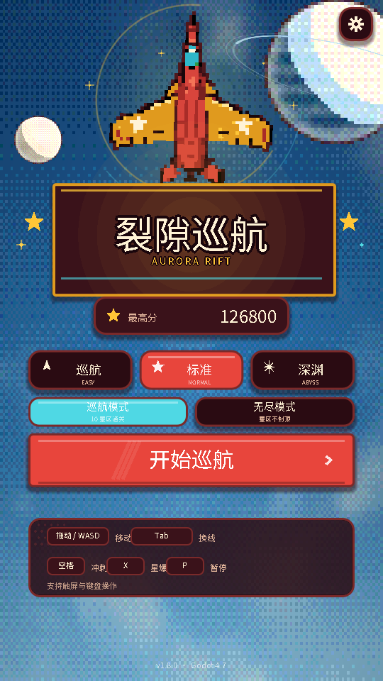
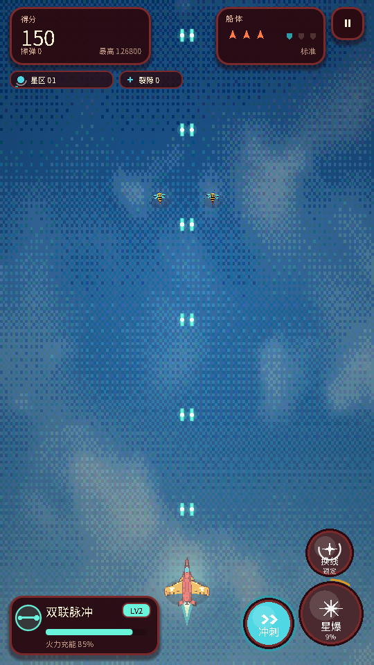
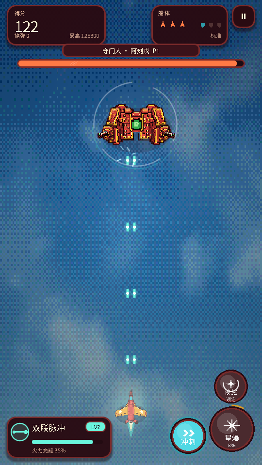
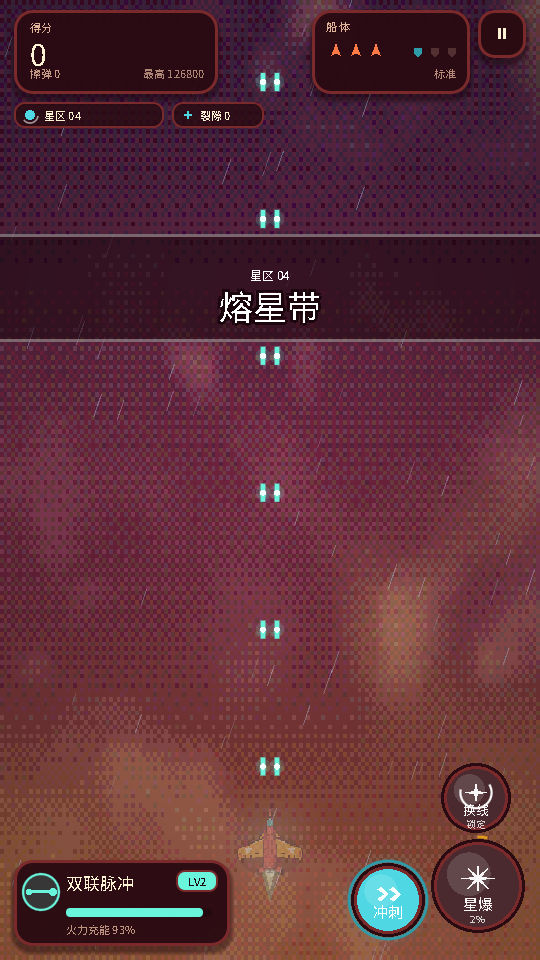
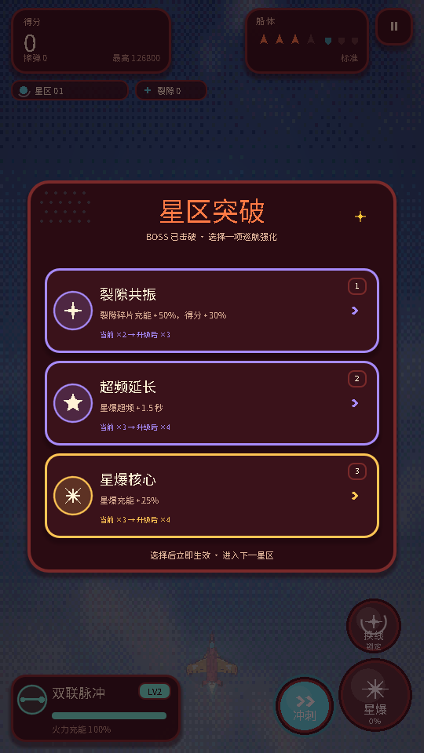
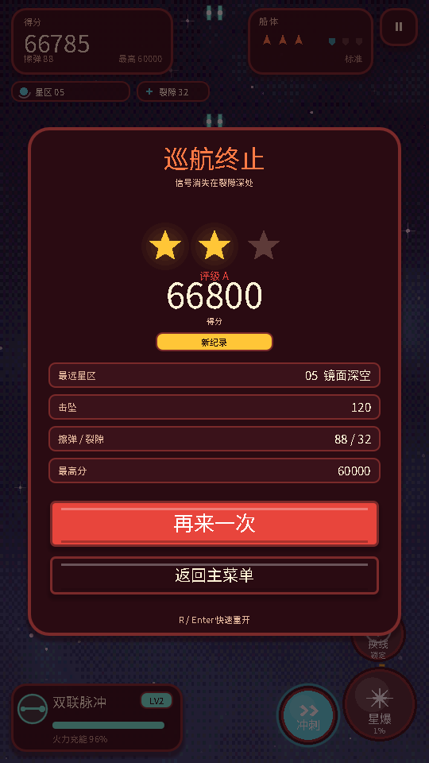

## v1.7.0 endless mode, three-star rating, weather and new icon

Benchmarked against 《像素飞机大战》 (Sky Wings). Four reference features landed:

- **Endless mode**: a segmented control on the main menu switches between
  campaign (10 zones, final boss) and endless (zones uncapped, all six bosses
  keep rotating, background palettes repeat every 10 zones). The furthest
  endless zone persists separately (`best_endless`); the best score stays shared.
- **Three-star rating**: the results card now shows three stars —
  1 = survived, 2 = ≥120 kills or ≥40 grazes, 3 = full hull and ≥20000 score.
  Thresholds live in `CFG.run_stars()`, so the numeric gate asserts them.
- **Dynamic weather**: zones rotate clear / clear / rain / storm every four
  sectors. The backdrop draws depth-sorted rain streaks, and storms add a
  lightning flash every 2.4–5.2 s; weather follows the zone automatically.
- **New launcher icon** generated with Doubao (Seedream) and converted by
  `tools/gen_icon_pixel.py` into a pixel-neon trio: the full icon, an adaptive
  foreground built from the in-game ship sprite plus a magenta glow, and a
  deep-space neon-grid adaptive background. Used for the desktop window and the
  Android launcher.
- Gate `VERIFY_OK checks=191`, `SELFTEST_OK n=10`.
- Android versionName `1.7.0` / code `25`.

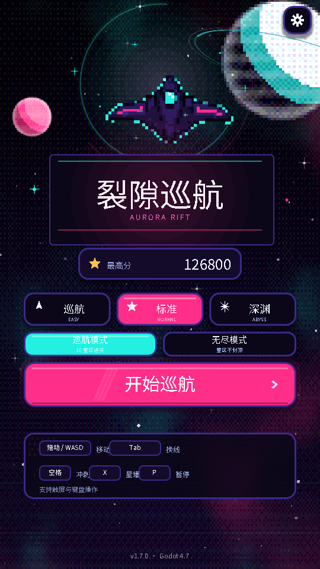
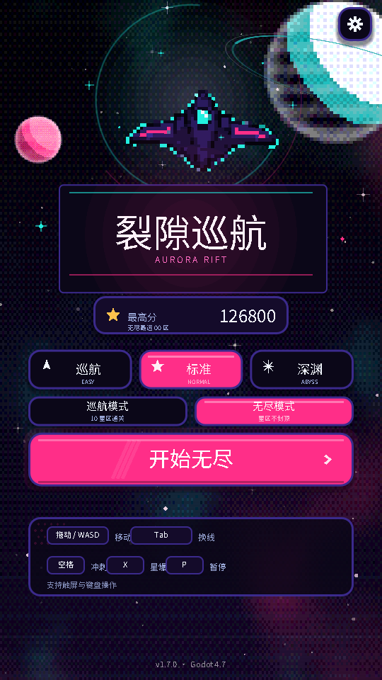
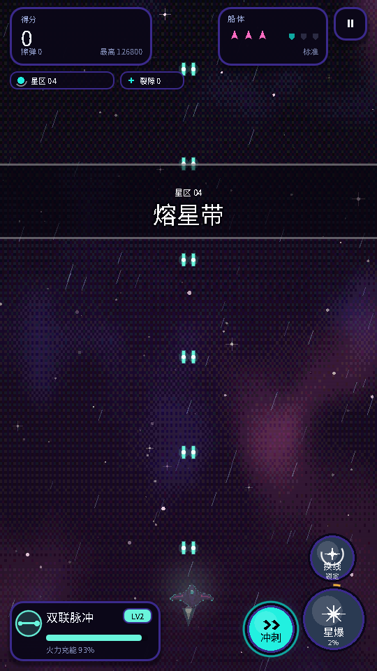
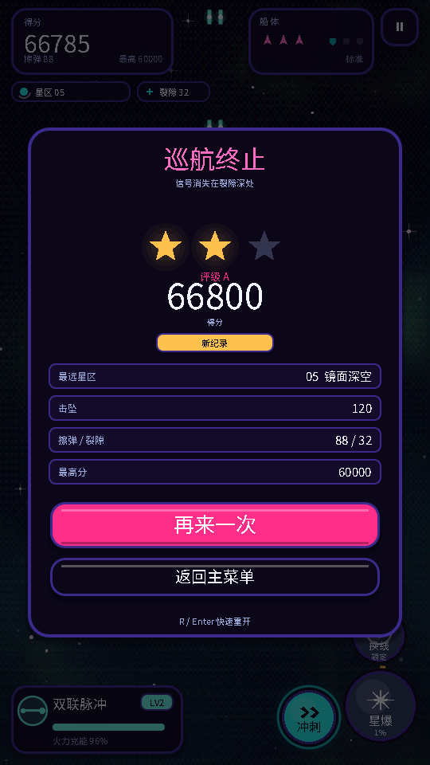
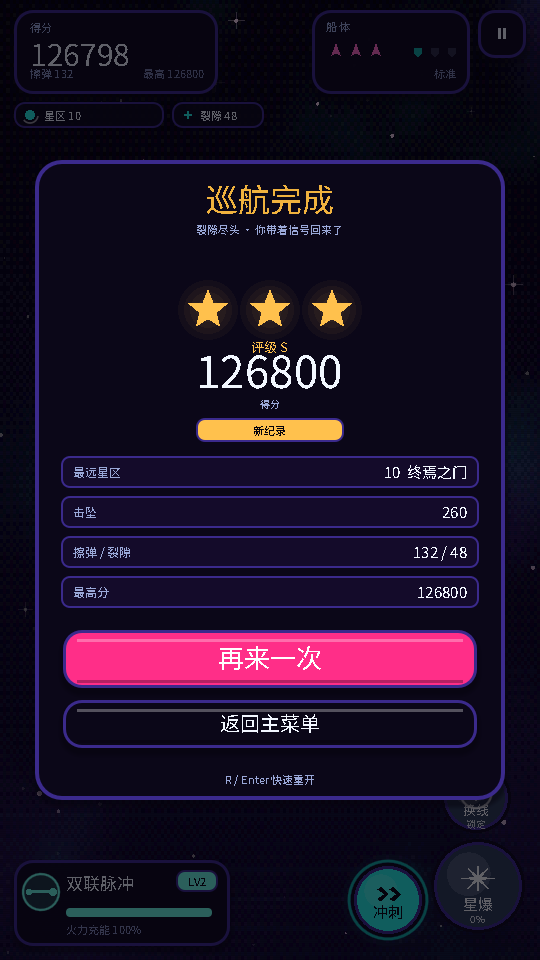

## v1.6.0 pixel neon art overhaul

Full art-direction change from cel-shaded anime to **pixel neon**, with the
ship/boss art generated by the Doubao (Seedream) image model and converted to
game sprites by `tools/pixel_neon.py`.

- **21 hero sprites regenerated** (3 player lines, 12 enemies, 6 bosses) with
  Doubao text-to-image, then: edge flood-fill background removal → trim →
  square to the 0.46 extent contract → nearest-neighbour downsample to a
  44/56/96 px pixel grid → quantize to a 20-colour neon palette → nearest
  upscale to 512/384/640 canvas. Masks are regenerated from alpha, so the hit
  flash and shield overlays still line up.
- **Crates and drones** re-pixelated from the previous art with the same
  palette (`--alpha` mode), so pickups match without another generation pass.
- **Background**: new pixel-quantised nebula shader — UV snapped to a 168-cell
  grid, Bayer 4×4 dithering to 11 levels, CRT scanlines, neon horizon lines;
  five palettes re-tuned to magenta/cyan/violet/orange.
- **Planets** pixelated in `planet_orb.gdshader` (72-cell grid + 8-level
  dither) so the menu decorations match the ships.
- **UI**: neon token palette (magenta `#FF2E88` / cyan `#22F0E0` on `#05030C`),
  corner radii 22/14/8 → 7/5/3, title switched from the 3D logo render to a
  live neon text title, boss halo rings drawn procedurally instead of using the
  old cel-shaded ring textures.
- **Textures use nearest-neighbour filtering** and the bundled CJK font runs
  with antialiasing/subpixel/hinting disabled, keeping glyph edges hard.
- Gameplay untouched: `VERIFY_OK checks=180`, `SELFTEST_OK n=8`.
- Android versionName `1.6.0` / code `24`.

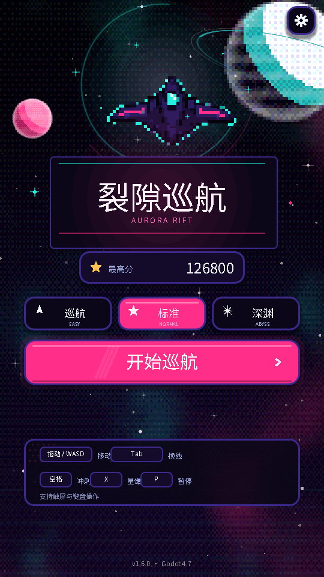
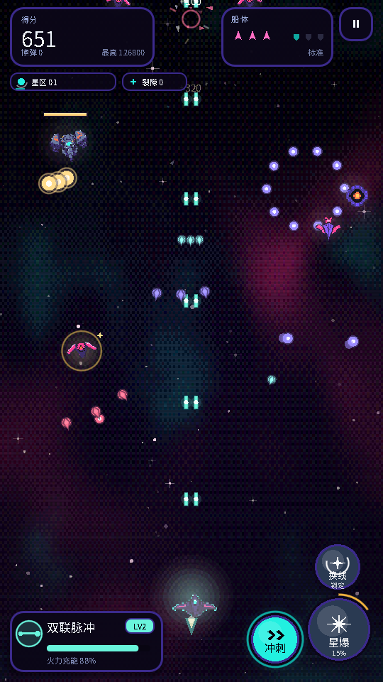
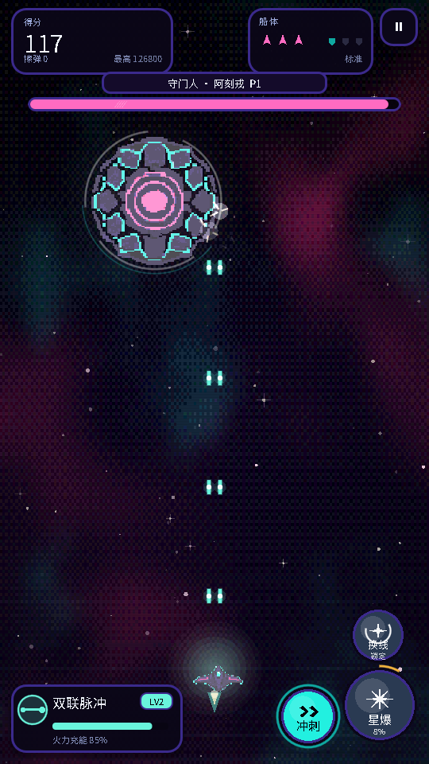
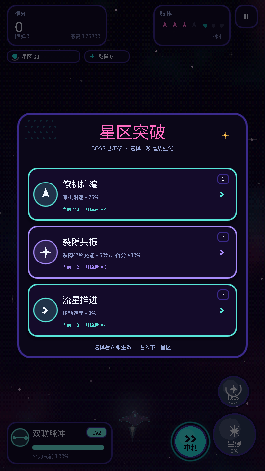

## v1.3.2 main.gd module split

Acting on the GS review suggestion, three responsibilities moved out of the
1.6k-line `main.gd` without changing gameplay:

- `WaveDirector` (105 lines): zone quota, 40 s minimum dwell, wave formations,
  enemy factory, boss trigger.
- `CollisionSystem` (140 lines): player bullets vs enemies/boss, per-frame
  player hazards/graze, kill rewards, player hit/death.
- `UpgradeSystem` (113 lines): draft pool filtering, ×N stacks, three-card roll
  and upgrade application.
- `main.gd` is now 1306 lines and keeps only orchestration, player/skills,
  crates/drones, input and drawing.
- Behavior unchanged: gate `checks=85`, selftest `n=5`, desktop/Android
  screenshots, boss draft → next-zone flow all re-verified.

## v1.3.1 GS review performance pass

Claude-Code-Game-Studios review (`gs-code-review`) over the whole project.
Findings fixed in this patch:

- **Per-frame hex colour parsing removed**: enemy base/accent colours and the
  player weapon tint are cached instead of `Color.html()` every frame
  (up to 84 parses/frame at 42 enemies).
- **Enemy muzzle colour cached** on `Enemy.setup()` instead of re-parsing the
  glow string on every shot.
- **FX particle ceiling**: 420 particles / 40 floating texts, oldest dropped
  first, so stacked novas/explosions cannot grow draw cost unbounded.
- Remaining suggestions are architectural (split `main.gd` 1.6k-line god object
  into wave/collision/upgrade modules) and tracked as follow-up, not blocking.

## v1.3.0 boss roster, per-zone BGM and longer zones

- **Six bosses**: three new cel-shaded silhouettes — 塔罗斯 / 铁壁 (wide
  dreadnought), 许德拉 / 噬星者 (vertical serpent), 塞拉弗 / 裁决者 (X-wing
  seraph) — rendered with the same Blender anime pipeline. Zones rotate all six
  (`(zone-1)%6`), each with its own 3-phase sequence and bullet tint.
- **Per-zone BGM**: ten synthetic 29–53 s loops (`tools/gen_music.py`, OGG,
  ~3.4 MB total) in `assets/music/`; `MusicPlayer` fades in on zone change
  (−40 → −12 dB) and pauses with the pause menu.
- **Longer zones**: kill quota `12 + 4×zone` → `28 + 4×zone`, plus a 40 s
  minimum dwell time (`ZONE_MIN_TIME`); a zone now runs ~45 s instead of ~20 s
  before the boss.
- **Ship switching**: the hull art did change, but the second weapon line
  unlocked too late. The first supply crate now guarantees 棱镜, the 换线
  button shows `锁定` until two lines are unlocked, and an early tap shows a
  hint.
- Gate `checks=85`; selftest `n=5` adds BGM and zone-pacing assertions.
- Android versionName `1.3.0` / code `14`.

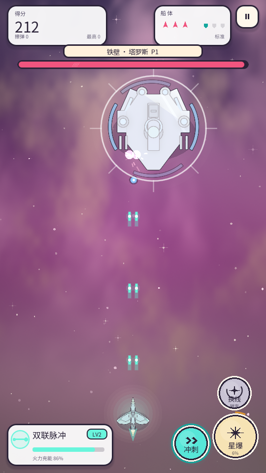
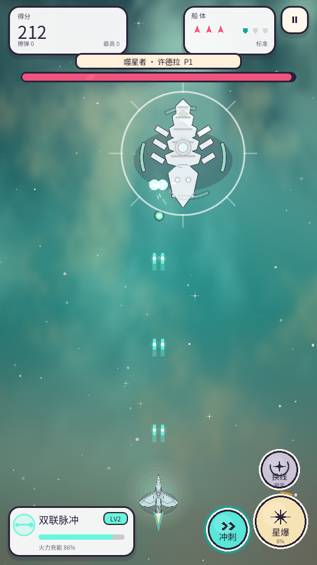
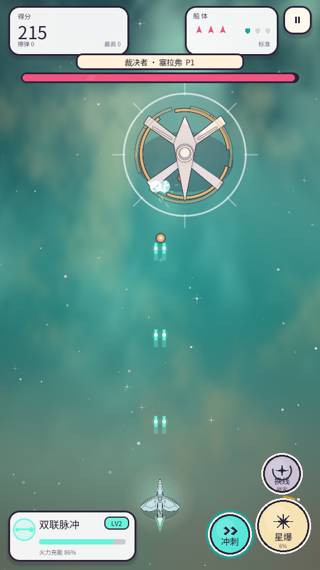
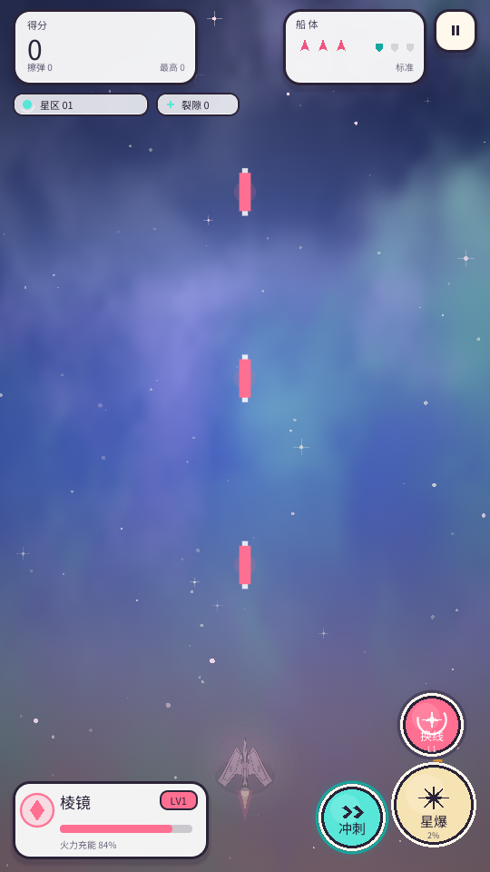

## v1.2.1 gameplay integrity + two-round polish

Two review/optimization rounds after v1.2.0. Correctness first, then build
and readability polish.

- **Per-frame player collision**: bullet-vs-player, body contact and grazing
  were nested inside the enemy-death callback, so the player was effectively
  invulnerable and graze fired only on kill frames. They now run in
  `_resolve_player_hazards()` every frame, aligned with the web `collide()`.
- **Death closes the draft**: a lethal hit can no longer leave the three-card
  draft covering the results screen.
- **No dead upgrade cards**: hull/shield/speed cards are filtered out at their
  caps; each card shows its current `×N` stack.
- **Zone progress bar** under the `星区` chip; results now report
  `擦弹 / 裂隙`.
- **Headless self-test**: `-selftest` asserts hit / graze+drop / death-closes-draft.
- Android versionName `1.2.1` / code `13`; numeric gate `checks=81`.

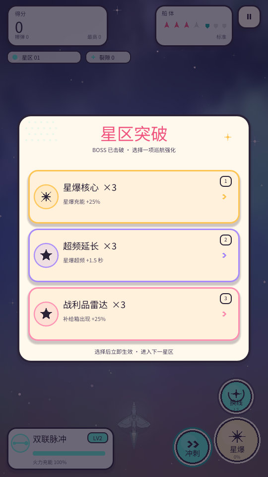
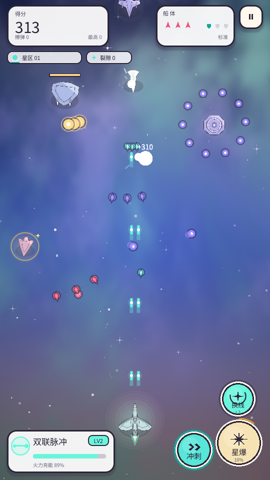
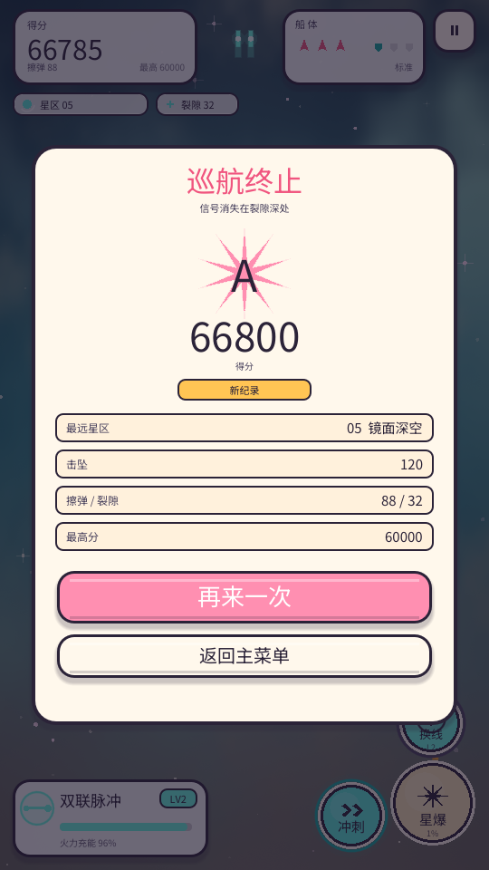

## v1.2.0 gameplay innovation

Benchmarked against Touhou (graze/bomb risk-reward), DoDonPachi (bullet-cancel
economy), Raiden/Sky Force (mobile readability and power-ups), Archero/Vampire
Survivors (in-run build choices) and Hades (three-choice boons). Gaps found:
graze had no mechanical payoff, and there was no inter-zone build agency.

- **裂隙碎片 (Rift Motes)**: every grazed bullet drops a magnetized shard.
  Collecting it adds score, extends the combo window, charges nova, and fills
  the new HUD `裂隙` counter. Grazing becomes a deliberate risk/reward loop
  instead of a hidden stat.
- **星区突破 three-card draft**: after every boss, the game freezes and offers
  3 of 10 run upgrades (damage, drone rate, max hull, shield, nova gain,
  overdrive duration, speed, crate rate, boss damage, rift resonance). Choices
  stack across the 10 zones and change how the run is played.
- No new touch button was added; the draft is modal and finger-friendly, and
  all upgrades are applied through existing systems.

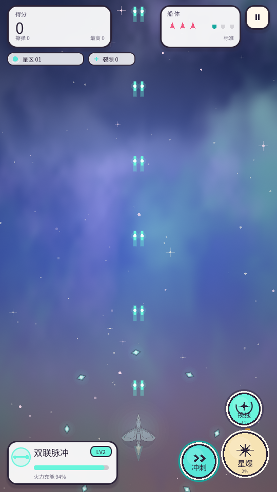
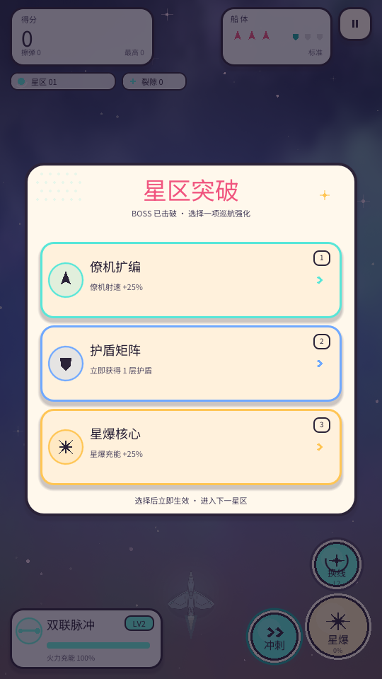
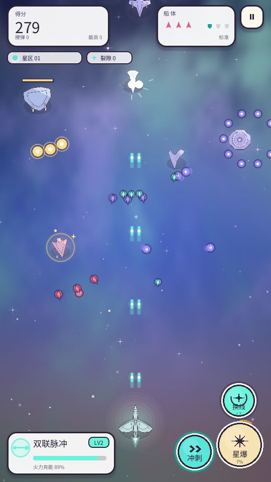

## v1.1.1 two-round polish

- **Cel-shaded planet/moon shader**: hard-banded spheres with ink edges and a
  ring, replacing the flat half-disc background orbs.
- **Mobile-first hints**: Android/phone menu now shows touch instructions
  (拖动屏幕 / 右下角技能 / 右上角暂停 / 换线键) instead of keyboard keycaps.
- **HUD Chinese pass**: 得分 / 最高 / 擦弹 / 星区; removed mixed English labels.
- **Three-button skill cluster**: 星爆 / 冲刺 / 换线; the 精准 slow-aim button
  and Shift focus mode were removed entirely.
- **Motion polish**: menu↔game fade, pause/results card slide-in, score count-up,
  smooth boss HP bar, start-button shimmer and arrow bounce.
- Android versionName `1.1.1` / code `11`; numeric gate `checks=75`.

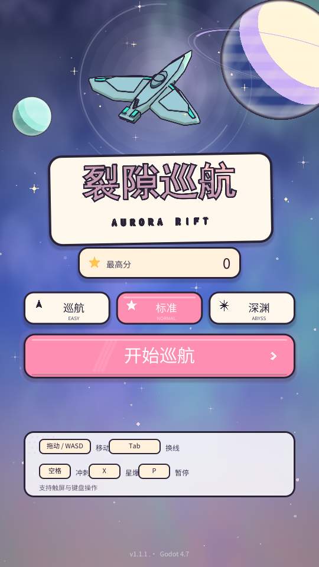
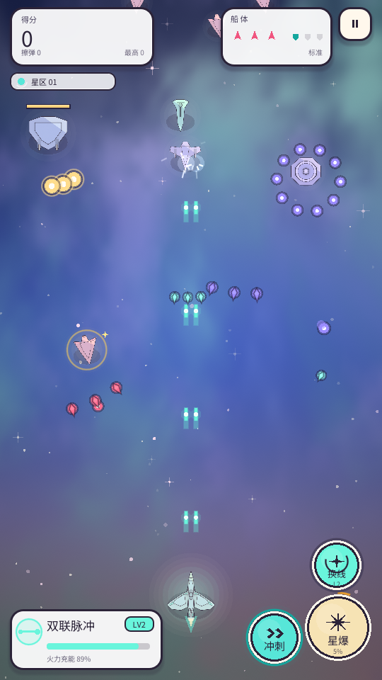
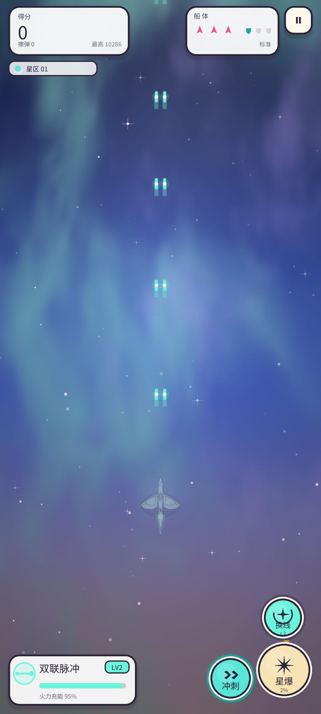

## v1.1.0 visual reset

- **Anime cel-shaded art**: all player/enemy/boss/drone/crate sprites re-rendered
  in Blender with two-tone shading, dark plum outlines, hand-painted highlights
  and supersampled anti-aliasing (`tools/artgen_anime.py`).
- **Key visual**: a 3/4 cel-shaded hero ship (`assets/keyart/hero.png`) and a
  3D beveled title logo (`assets/keyart/logo.png`) rendered for the menu.
- **Adaptive full-screen layout**: `stretch/aspect="expand"`, dynamic
  `CFG.VIEW`, safe-area insets (notch/navigation bar) and HUD/controls anchored
  to the real viewport. Verified at 540x960, 540x1061 (long phone), 720x960
  (tablet) and on an Android emulator at 1080x1920 / 1080x2400 with hardware
  GPU passthrough.
- **New UI**: cream sticker panels, ink outlines, candy-colored chips/buttons,
  live boss bar, pause and results cards, floating combo text, redesigned touch
  controls.
- **New background**: animated FBM nebula shader, three parallax star layers,
  cel-shaded planet/moon, gameplay-only bottom dimming for bullet readability.
- **New FX**: explosions, shards, shockwave rings, hit sparks, pickup text,
  screen shake, engine flames, dash afterimages and bullet-type silhouettes.
- **New app icon** generated from the 3/4 hero render.

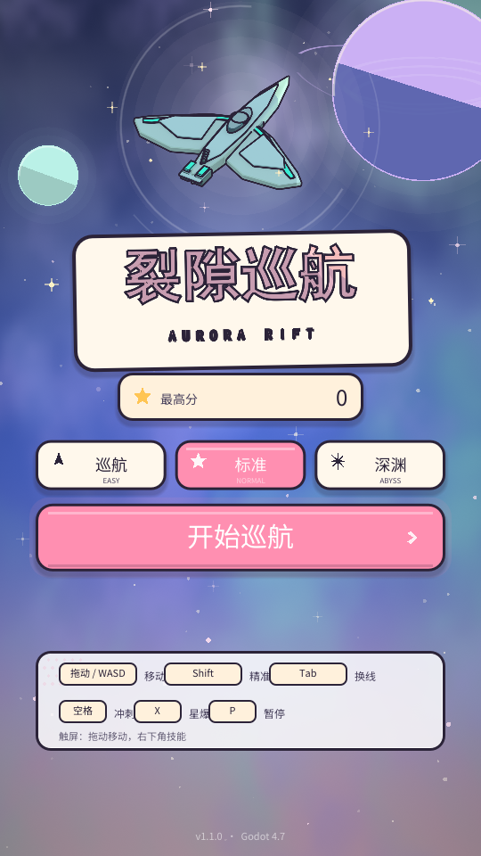
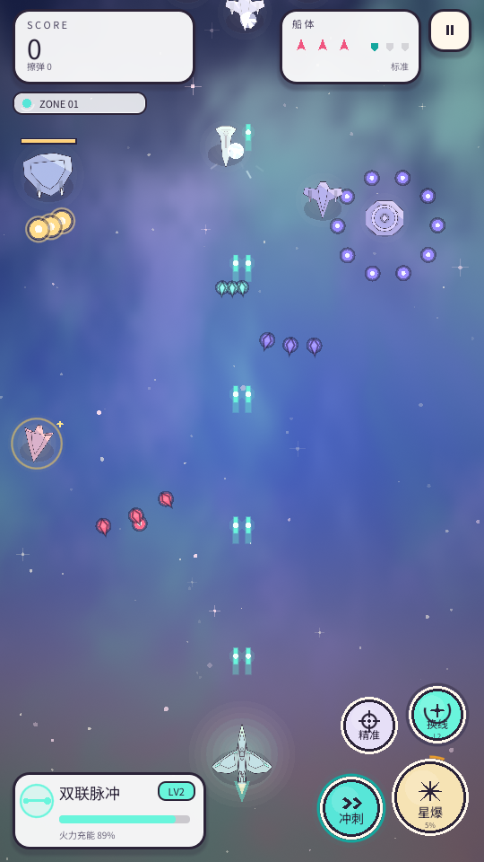
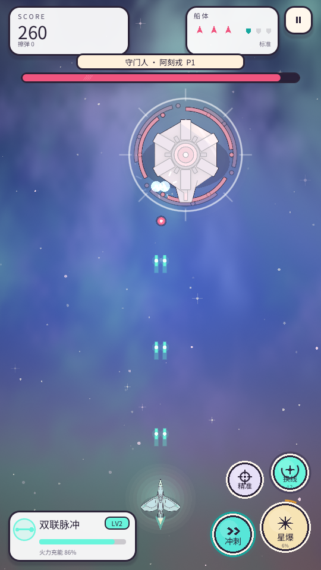
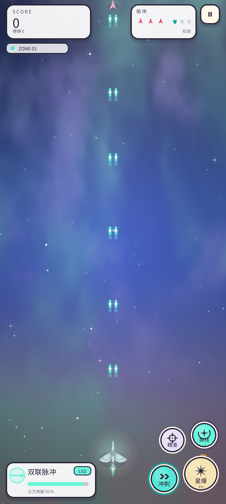
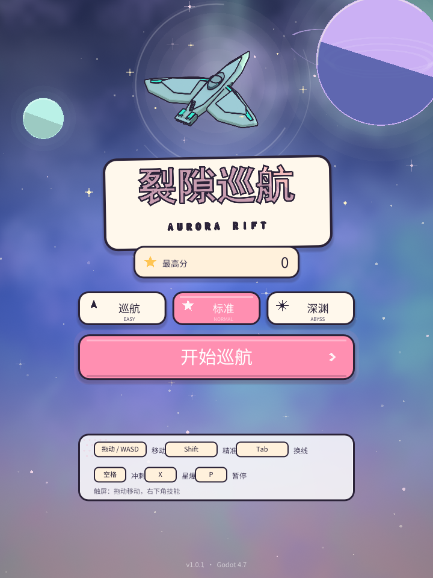

## Status

- [x] Godot **4.7.2 stable** installed, export templates installed
- [x] Project skeleton at 540x960 design size, portrait, `canvas_items`
      `expand` stretch + dynamic `CFG.VIEW` + safe-area insets
- [x] Playable core: keyboard + mouse/touch drag, pulse auto-fire, four enemy
      archetypes, aimed/fan/ring fire, swept collision, graze, score/lives,
      pause/restart, difficulty keys 1/2/3
- [x] Numeric gate `tools/verify_numbers.gd` (**85 checks**) plus headless
      `-selftest` behaviour assertions (`SELFTEST_OK n=8`)
- [x] **Cel-shaded sprite art**: player + 12 enemy hulls + **6 bosses** +
      drones + crates re-rendered in Blender into `assets/ships/`,
      including hit-flash masks and boss rings. Drawn via the `ShipArt` contract
      (visual outer edge = radius, canvas side = radius / 0.46); polygon fallback
      kept if a texture is missing.
- [x] **App icon (v1.1.0)**: cel-shaded 3/4 hero on a pastel nebula
      (`assets/icons/`), wired into the project icon, Windows exe icon and
      Android adaptive launcher icon.
- [x] Windows release export: `build/windows/SpaceFighter.exe` (v1.6.0.0)
- [x] Android APK: `SpaceFighter-Godot-v1.6.0.apk` (portrait, target SDK
      36, release-signed with the project keystore)
- [x] On-device install verified: Android 36 emulator with hardware GPU
      (1080x1920 and 1080x2400), versionName 1.6.0 / code 24, no black bars,
      touch controls work, 0 Godot script/shader errors
- [x] Release signing: project keystore (CN=Space Fighter, O=sctale), v2/v3 verified
      (`apksigner verify --verbose`)
- [x] Touch controls: 星爆 / 冲刺 / 换线 rings + top-right pause + menu buttons
- [x] Bundled Noto CJK subset (`assets/fonts/AuroraCJK.ttf`, 296 KB, 817 chars)
- [x] Numeric parity: enemy hit radius `size * 0.78`, enemy bullet speed
      `min(300, 150×(1+tier×0.14))` (web `entities.js:1263,1393`)
- [x] All 12 enemy behaviours, elite affixes, 6 movement / 9 fire modes,
      zone/tier scaling, kill-quota director
- [x] Three weapon lines (charge/detune/resonance), 5 levels, swap/cycle,
      homing swarm, piercing prism, overdrive; shields/hull, dash, nova
- [x] Drones (4 kinds, unique pick), supply crates (10 kinds, magnet),
      nova/overdrive, combo multiplier, grading (S/A/B/C)
- [x] Three bosses × 22 original named moves × per-phase fixed sequences,
      66%/30%/12% phases, break gauge + stun, 0.5 s telegraph with colour families
- [x] 10 zone skies + soft nebulae, procedural SFX (shot/hit/boom/pick/nova),
      menu / pause / results screens with persisted best score
- [x] Wave director: line / V / twin-column / cluster / pincer formations,
      elite squad every 4th wave, boss at each zone quota
- [x] Git repository + GitHub release (sctale/SpaceFighter-Godot)

## Run

```bash
godot --path D:\V-Coding\space-fighter-godot
```

Controls: WASD/arrows move, mouse/touch drag, Tab switch weapon, Space dash,
X nova, 1/2/3 difficulty, P/Escape pause, R restart.

## Numeric gate

```bash
godot --headless --path D:\V-Coding\space-fighter-godot \
  --script res://tools/verify_numbers.gd
```

Expected: `VERIFY_OK checks=180` and exit code 0.

## Behaviour self-test

```bash
godot --headless --path D:\V-Coding\space-fighter-godot -- -selftest
```

Expected: `SELFTEST_OK n=8` and exit code 0.

## Export

```bash
# Windows release (embedded PCK)
godot --headless --path D:\V-Coding\space-fighter-godot \
  --export-release "Windows Desktop" build/windows/SpaceFighter.exe

# Android release APK (requires Android SDK + JDK; Godot auto-detects both)
godot --headless --path D:\V-Coding\space-fighter-godot \
  --export-release "Android" build/android/SpaceFighter-release.apk
```

Both presets use `exclude_filter="reference/*,docs/*,build/*,.trae/*"`, so
screenshots and build artifacts never enter the shipped packs. The APK is
signed with the project keystore in `keystore/` (gitignored); verify with
`apksigner verify --verbose`.

## Reference

`reference/` is excluded from Godot import (`.gdignore`). It contains the original
web source, design docs, and Blender art generator. Do not edit it as game code;
port from it.

## Migration rules

1. Keep the 540x960 design coordinates and original numeric constants; the
   runtime viewport may expand to any phone aspect (`CFG.VIEW`), but gameplay
   values stay in design pixels. Do not reintroduce the Unity 0.025 world scale.
2. Player hit radius is **4.6 px**, graze radius **28 px**; the drawn hull is
   deliberately much larger (36 px visual radius).
3. Use swept segment-circle collision for bullets; do not use per-frame point
   checks.
4. Add a gate assertion before adding a new subsystem, then port the web logic.
5. Keep the game playable after each slice; do not port UI/audio before the core
   loop and collisions are verified.
6. Sprite sizing follows the Unity `ShipArt` contract: the PNG canvas's max
   radius is `0.46 × edge`, so to make the visual outer edge equal the hit
   radius, draw the texture at `side = radius / 0.46`, centered. Player hull
   visual radius is 36 px (78.3 px canvas); enemy hulls are pre-rendered
   nose-down, player nose-up — do not rotate them 180°.

## Art provenance

The v1.1.0 sprites are re-renders of the archived Unity geometry using the
project's own cel-shading pipeline, not the original PBR renders:

- `tools/artgen_anime.py` — imports `reference/artgen/blender/gen_art.py`
  (read-only source of the procedural models), swaps in `tools/anime_toon.py`
  cel materials (two-tone shading, AO, diagonal gloss, Fresnel rim, Freestyle
  outer/inner lines), renders at 2x and downscales to the existing 512/384/640
  canvases. The `0.46 × side` art contract, mask and boss ring layers are
  unchanged.
- `tools/artgen_keyart.py` — 3/4 hero ship and 3D title logo.
- `tools/gen_icon_anime.py` — legacy + adaptive launcher icon.
- `assets/ships/*.png` (94 files) and `assets/keyart/` were produced by these
  scripts; `*_mask.png` are white silhouettes for hit-flash.
- Bullets stay procedural; the legacy `bullet_*.png` files are not used.

Rebuild examples:

```bash
blender -b --factory-startup --python tools/artgen_anime.py -- \
  --only player_pulse,boss_gatekeeper --out build/art_anime --samples 24
blender -b --factory-startup --python tools/artgen_keyart.py -- --only hero,logo
python tools/gen_icon_anime.py
```

## Release signing

Release APKs are signed with the project keystore (kept **local only**,
`keystore/` is gitignored):

- keystore: `keystore/spacefighter.keystore`
- alias: `spacefighter`, store/key password: `spacefighter`
- certificate: `CN=Space Fighter, OU=Games, O=sctale`

Export: `godot --headless --path . --export-release "Android" build/android/SpaceFighter-release.apk`.
The debug keystore (`CN=Godot`) produces a different signature, so switching
between them requires uninstalling the app first.
